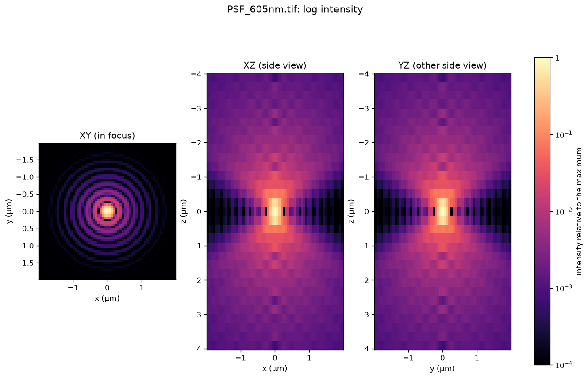
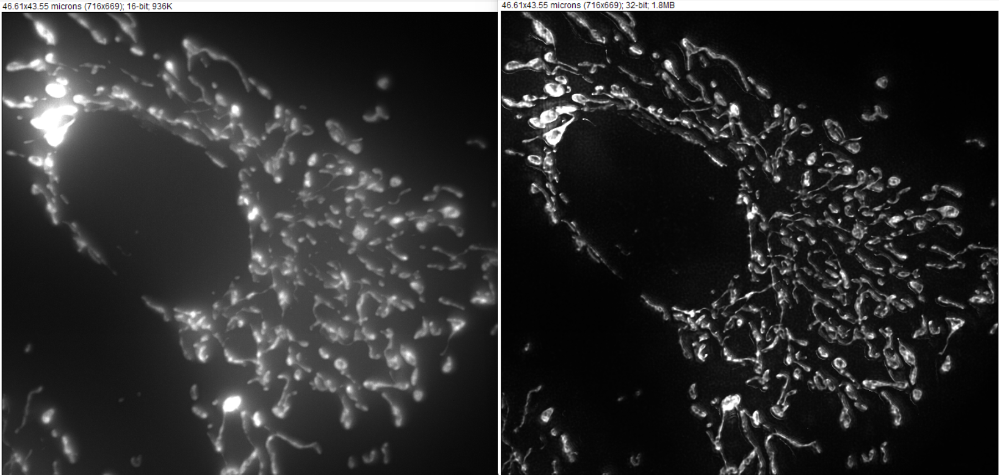

# Deconvolution

Microscope images are produced by convolution of an object with the Point Spread Function of the microscope.  A Point Spread Function (PSF) defines how the microscope images a very small point (significantly smaller than the resolution of the microscope).  The PSF depends very much on the objective lens used - especially on the numerical aperture of the objective lens - but also on other parameters, such as the magnification to the camera, pixel size of the camera, the refractive index of the sample, and how deep in the sample the point is located.  Since the image you acquire is a convolution of the object with the PSF, it seems worthwhile to think about deconvolving the image with the PSF to better approximate the object that you are interested in.

We learned that convolution in real space is multiplication in Fourier (frequency) space, hence deconvolution is division of the image with the PSF in frequency space.  Since real images (and the PSF) contain noise, divisions in frequency space lead to wildly exploding noise.  To get around this problem, deconvolution algorithms often start with a guess about the true object, convolve this guess with the microscope PSF to find out what the microscope would see with this object, and compare the image to the actual image.  The algorithm then improves its estimate of the object, convolves this with the PSF, and iteratively constructs the best guess for the object through error minimization.  Often, some real-world physical rules, such as a positivity constraint (there is no such thing as negative light intensity) are used.

To use deconvolution, one first needs an estimate of the microscope's Point Spread Function (PSF).  The PSF depends on the objective lens (especially its numerical aperture), but also on the wavelength of the light and everything in the light path (the PSF of a confocal system will be very different from the PSF of the same microscope operated in wide field mode).  The best way to obtain the PSF estimate is to image small (smaller than the diffraction limit) beads that are fluorescent.  However, it is also possible to make theoretical predictions about the PSF, given your knowledge about the magnification, wavelength, NA, etc. There are different approaches, the most widely used is the Airy disk model of the PSF.  I include a script (src/deconvolution/make_airy_psf.py) that lets you generate a theoretical PSF for your (wide field) microscope.  

* Use the script make_airy_psf.py to generate a PSF for an objective lens with an NA of 1.2, water immersion (ri = 1.33), z-step of 0.3 micron, wavelength of 500 nm and pixel size of 0.08 micron.  Inspect the resulting PSF in napari. 

A popular algorithm for deconvolution is [Richardson-Lucy](https://en.wikipedia.org/wiki/Richardson%E2%80%93Lucy_deconvolution).  It uses a Poisson model for noise, well-suited for photon shot noise.  One problem is that it tends to amplify artifacts when run for too many iterations, even though the quality factor (i.e. how well is the measured image predicted by convolving the generated image with the PSF) improves.  To address this problem, Andy York proposed to deconvolve two images simultaneously, where the photons from the original images are randomly distributed to the two images (as if the two images were acquired using two identical sensors with a 50/50 beam splitter).  The algorithm continues as long as the result of each iteration agrees between the two images, and stops when they no longer do.  This stopping criterion is per pixel, hence noisy parts of the image will stop sooner than high Signal/Noise areas.  James Manton wrote code for this approach that can be found on [Google Colab](https://colab.research.google.com/drive/1mfVNSCaYHz1g56g92xBkIoa8190XNJpJ#scrollTo=NtxvWB8q2F2Y).  I use his [version](https://colab.research.google.com/drive/10Mu7s62XHFCShSxsdE7cPXW3yLoCbh2d#scrollTo=Tnk_66fHlmVq) that is accelerated according to [Biggs and Andrews](https://opg.optica.org/ao/abstract.cfm?uri=ao-36-8-1766) to run locally with GPU acceleration, which you can find in [src/deconvolution/deconvolve_gradient_consensus.py](../src/deconvolution/deconvolve_gradient_consensus.py).  I used it to deconvolve the data set in our shared Box folder named "BPAE_100x_ZStack_3Crop". 

